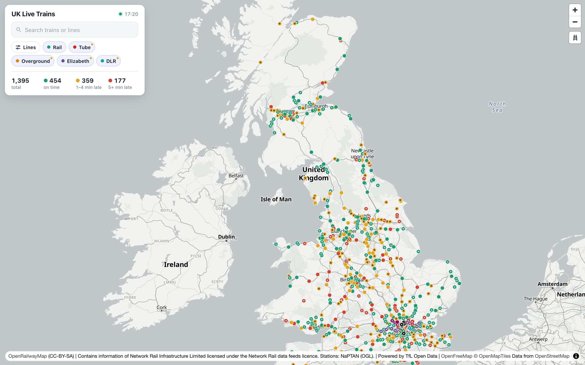
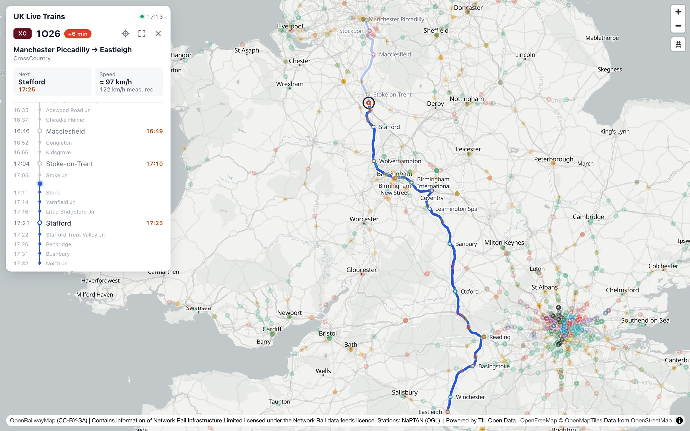
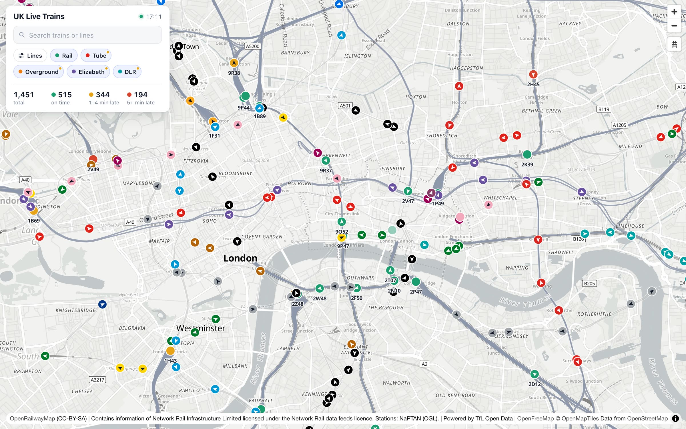
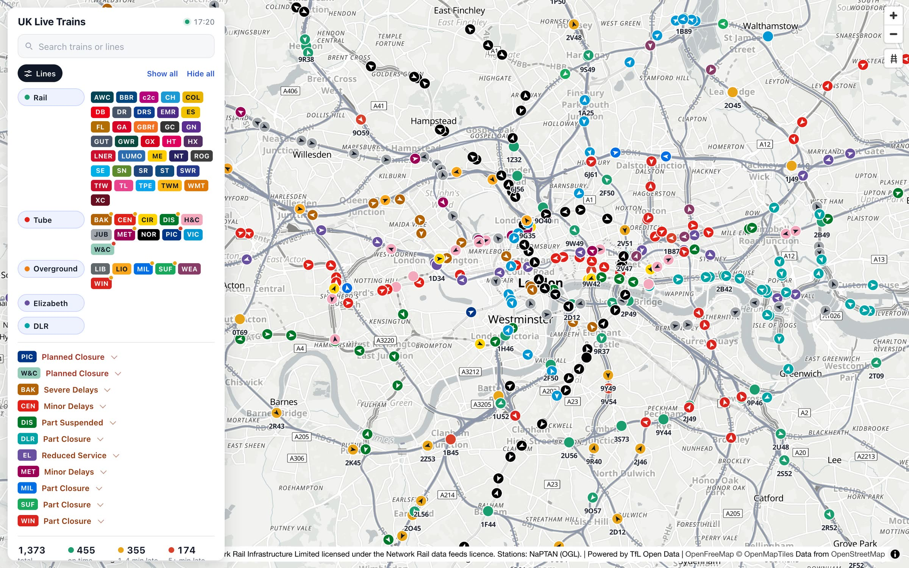
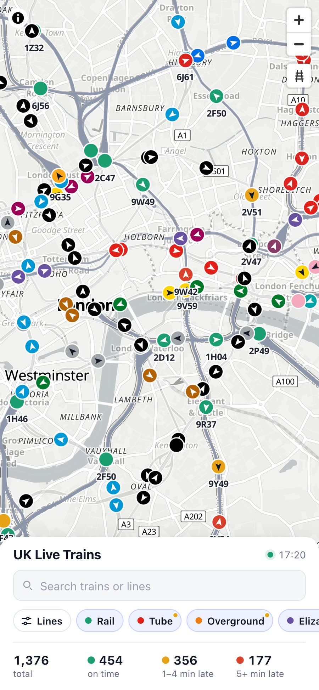
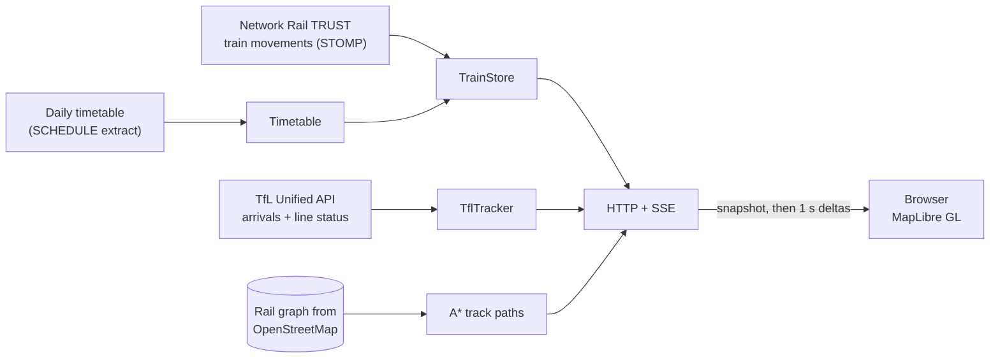

<div align="center">


# UK Live Trains

**Every train in Great Britain, moving on one map, in real time.**

National Rail from Network Rail's open data feeds, plus the Tube, Overground, Elizabeth line and DLR from TfL.<br>
Trains glide along the real track, each with its whole route, next stop, delay and speed.

[](https://github.com/simpleapples/uk-train-live/actions/workflows/ci.yml)
[](LICENSE)
[](package.json)
[](package.json)
[](#-deploy-with-docker)

[Quick start](#-quick-start) · [Features](#-features) · [How it works](#-how-it-works) · [Deploy](#-deploy-with-docker) · [中文说明](README.zh-CN.md)

<br>



<sub>A Sunday afternoon: about 1,450 trains on the map at once.</sub>

</div>

---

## ✨ Features

- 🚆 **Every train, live.** All National Rail passenger and freight trains reporting to Network Rail, plus 19 TfL lines: 11 Underground lines, 6 Overground lines, the Elizabeth line and the DLR.
- 🛤️ **On the real track, not straight lines.** Trains are animated along OpenStreetMap track geometry, routed with A\* over a rail graph of 25,000 edges. Each TfL line routes only on its own track.
- 🧭 **Direction and punctuality at a glance.** Every dot carries an arrow for its direction of travel. National Rail trains are coloured by lateness; TfL trains in their line colour.
- 🗺️ **The whole route, one click away.** Origin → destination, then every calling point with planned, actual and expected times, from Network Rail's daily timetable. The track the train has covered fades out behind it as it moves.
- 🚦 **Line status built in.** TfL closures and delays are flagged on each line, so a quiet line explains itself (e.g. "Piccadilly: Planned Closure").
- 🔎 **Search and filter.** Find a train by headcode, line, operator or destination. Show any mix of networks, lines and operators, like "only the Central line and LNER".
- ⚡ **Fast and light.** One Server-Sent Events stream with one-second deltas, gzip throughout, and batched track geometry. Trains survive server restarts.
- 📦 **Zero runtime dependencies.** Node runs the TypeScript sources directly. `docker compose up` and you're live.
- 📱 **Works on phones**, with a bottom-sheet layout.

## 📸 Screenshots

<table>
  <tr>
    <td width="50%"><br><sub><b>Click a train</b> for its route, stops and times. Covered track fades behind it.</sub></td>
    <td width="50%"><br><sub><b>London</b>: Tube trains in line colours, National Rail by punctuality, headcodes when zoomed in.</sub></td>
  </tr>
  <tr>
    <td width="50%"><br><sub><b>Pick lines and operators</b>, and see today's closures and delays.</sub></td>
    <td width="50%" align="center"><br><sub><b>On a phone.</b></sub></td>
  </tr>
</table>

## 🚀 Quick start

You need **Node.js 22.18 or newer**. Nothing to install: the app has no runtime dependencies.

```bash
git clone https://github.com/simpleapples/uk-train-live.git
cd uk-train-live
npm run demo
```

Open **http://localhost:3000**.

Demo mode needs no account. It **simulates** National Rail (about 200 trains on 28 services, sent through exactly the same pipeline as real data) and shows **real, live** TfL trains.

### 🔴 Live National Rail data

1. Register (free) at [Network Rail Open Data](https://publicdatafeeds.networkrail.co.uk). Feed subscriptions are on the [My Feeds](https://publicdatafeeds.networkrail.co.uk/ntrod/myFeeds) page. The service is limited to 1,000 users, first come first served.
2. Copy `.env.example` to `.env` and fill in `NROD_USERNAME` and `NROD_PASSWORD`.
3. Run:

   ```bash
   npm run live
   ```

On first start the server downloads, with the same account, the CORPUS location codes and today's full timetable (~140 MB, a few seconds) into `state/`. It refreshes the timetable every night. Within a minute or two hundreds of real trains are on the map, and it keeps filling as trains report.

## 🐳 Deploy with Docker

```bash
cp .env.example .env    # add NROD_USERNAME and NROD_PASSWORD
docker compose up -d --build
```

- Always runs live data, whatever `FEED` says in `.env`.
- Change the port with `HOST_PORT=8080 docker compose up -d`.
- The timetable, CORPUS and the trains on the map live in the `state` volume, so restarts and upgrades pick up where they left off.
- `docker stop` lets the server save its trains first. The container has a health check on `/api/status`.
- Behind an HTTPS reverse proxy (nginx, Caddy), don't buffer `/api/stream`: it's a long-lived Server-Sent Events connection. The server already sends `X-Accel-Buffering: no`.

## 🧠 How it works



- **No public feed gives GPS positions.** Network Rail's TRUST feed reports a train each time it passes a timing point: when, how late, which timing point is next, and how many minutes away. The server keeps one *segment* per train (from, to, departure time, running time). The browser fetches the track between the two points and slides the train along it, so the server pushes changes, not positions.
- **Each train is matched to its schedule.** Live mode reads Network Rail's daily full timetable extract and keeps only today's ~25,000 schedules (about 15 MB in memory). A train is matched by the schedule id in its activation message; a train already running when the server starts is matched by headcode, place and planned time. About 93% of trains match. The rest are mostly same-day extras.
- **TfL gives predictions, not positions.** For each train the Unified API says how many seconds it is from each upcoming station. The previous station comes from the line's station order. The speed comes from the gaps between predictions, and the position from how much of the section is left. DLR predictions carry no train numbers, so DLR trains are inferred from per-station predictions.
- **Track geometry is built from OpenStreetMap.** The national network comes from OpenFreeMap vector tiles, and TfL lines from OSM route relations, one graph per line. Junctions are rebuilt by joining line ends within 25 m.

<details>
<summary><b>Project layout</b></summary>

| Path | What it does |
|---|---|
| `src/server.ts` | Entry point: picks the feed (`demo` or `nrod`), wires everything up |
| `src/app.ts` | HTTP server: static files, `/api/trains`, `/api/train`, `/api/paths`, `/api/stream` (SSE) |
| `src/engine/trainStore.ts` | TRUST messages → where each train is (the core) |
| `src/engine/track.ts`, `paths.ts` | Rail graph, snapping and A* routing; cached track between two places |
| `src/engine/trainDetails.ts` | A selected train's stops, previous/next stop and route geometry |
| `src/schedule/` | Daily timetable: download, parse, match trains to schedules |
| `src/tfl/tflTracker.ts` | TfL arrivals → train positions, speeds and routes; line status |
| `src/feeds/` | Live (NROD) and demo feeds, operator codes, portal downloads |
| `src/stomp/` | A small STOMP client with heart-beats and reconnect (no dependencies) |
| `public/` | The map page (MapLibre GL, vanilla JS) |
| `scripts/` | Rebuild the data in `data/` (stations, track, TfL lines) |

</details>

<details>
<summary><b>Rebuilding the map data</b></summary>

The built data is committed in `data/`. To rebuild it (needs `npm install` for the build tools):

```bash
npm run data:stations   # NaPTAN stations → data/stations.json
npm run data:track      # OSM rail graph from OpenFreeMap tiles → data/track.json.gz
npm run data:tfl        # TfL lines, stations and per-line track → data/tfl*.json*
```

</details>

## ⚠️ Limitations

- **Positions are estimates**, interpolated between reports along the track. They are not GPS.
- **TRUST only reports at timing points**, which can be several kilometres apart. Junctions without coordinates are bridged from the last known station.
- **Speeds are section averages**: estimated from the timetable or TfL predictions, and measured between reports. They are not instantaneous.
- **Same-day extra trains** (VSTP) aren't in the daily timetable, so they show "From X" instead of a full route.
- **OpenRailwayMap's public tiles** are fine for a prototype. A busy public site should host its own.

## 🛣️ Roadmap

- [ ] VSTP feed, for same-day extra trains
- [ ] TD (Train Describer) for signal-berth precision, one area at a time
- [ ] Darwin, for predicted delays, platforms and cancellations
- [ ] Only send trains in the viewport
- [ ] Replay a day

Ideas and pull requests are very welcome.

## 🤝 Contributing

```bash
npm install     # dev tools: TypeScript and Vitest
npm test        # 80+ tests
npm run typecheck
```

Please keep the zero-runtime-dependency spirit, and make sure tests and the type check pass.

## 📜 Data and licences

The code is [MIT](LICENSE). The data it uses comes with its own terms, and the app shows the required attributions in the map's ⓘ:

| Data | Source | Licence / attribution |
|---|---|---|
| Train movements, timetable, CORPUS | [Network Rail Open Data](https://publicdatafeeds.networkrail.co.uk) | Network Rail data feeds licence: *"Contains information of Network Rail Infrastructure Limited licensed under the Network Rail data feeds licence."* No Network Rail, National Rail or train company logos; operators are shown as text badges. |
| Tube, Overground, Elizabeth line, DLR | [TfL Unified API](https://api-portal.tfl.gov.uk) | *Powered by TfL Open Data.* Contains OS data © Crown copyright and database rights. |
| Station locations (`data/stations.json`) | NaPTAN, Department for Transport | Open Government Licence v3.0 |
| Track geometry (`data/track.json.gz`, `data/tfl-track.json.gz`) | © [OpenStreetMap](https://www.openstreetmap.org/copyright) contributors, via [OpenFreeMap](https://openfreemap.org) / OpenMapTiles and Overpass | [ODbL](https://opendatacommons.org/licenses/odbl/) |
| Basemap and rail overlay | [OpenFreeMap](https://openfreemap.org), [OpenRailwayMap](https://www.openrailwaymap.org) | © OpenMapTiles © OpenStreetMap contributors; CC-BY-SA |

> **Not affiliated with** Network Rail, National Rail, Transport for London or any train operator.

## 🙏 Acknowledgements

[Network Rail Open Data](https://publicdatafeeds.networkrail.co.uk) and the [Open Rail Data](https://wiki.openraildata.com) community wiki, [TfL Open Data](https://tfl.gov.uk/info-for/open-data-users/), [OpenStreetMap](https://www.openstreetmap.org) contributors, [OpenFreeMap](https://openfreemap.org), [OpenRailwayMap](https://www.openrailwaymap.org) and [MapLibre](https://maplibre.org).

<div align="center"><sub>If you like it, a ⭐ helps others find it.</sub></div>
