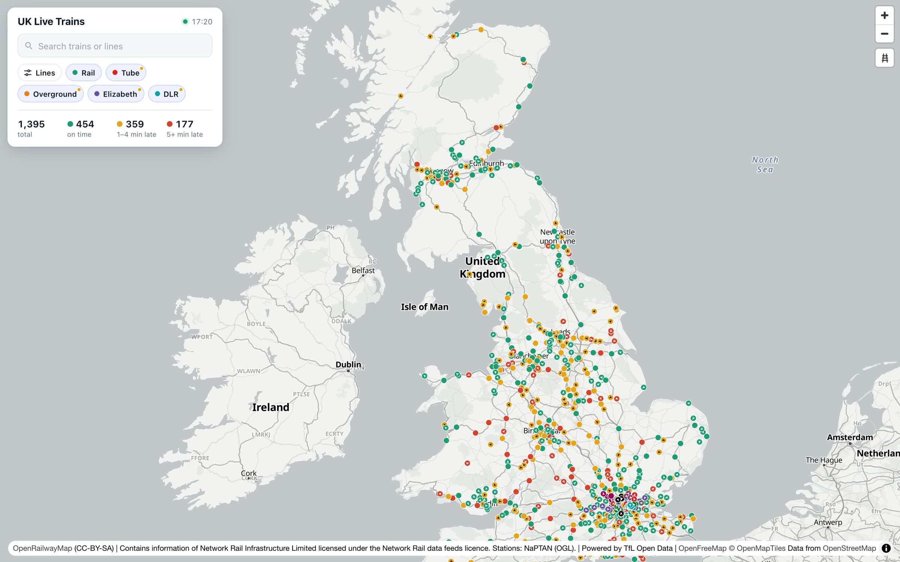
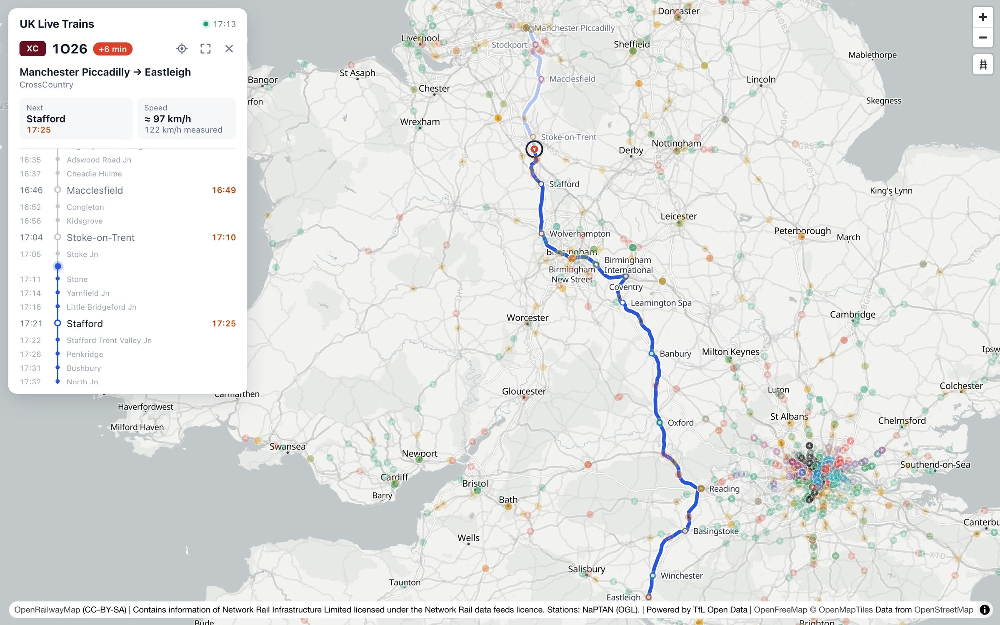
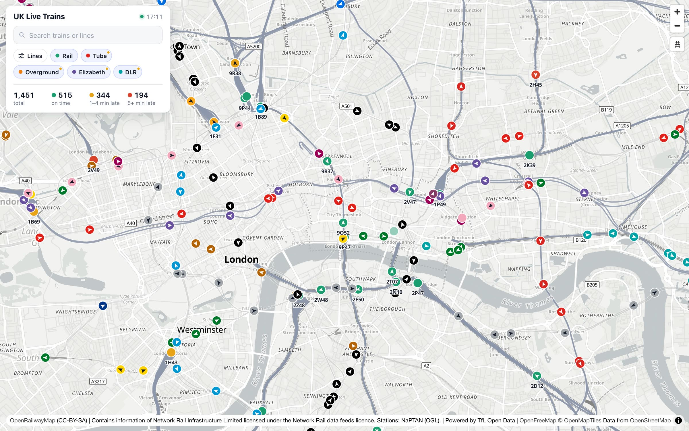
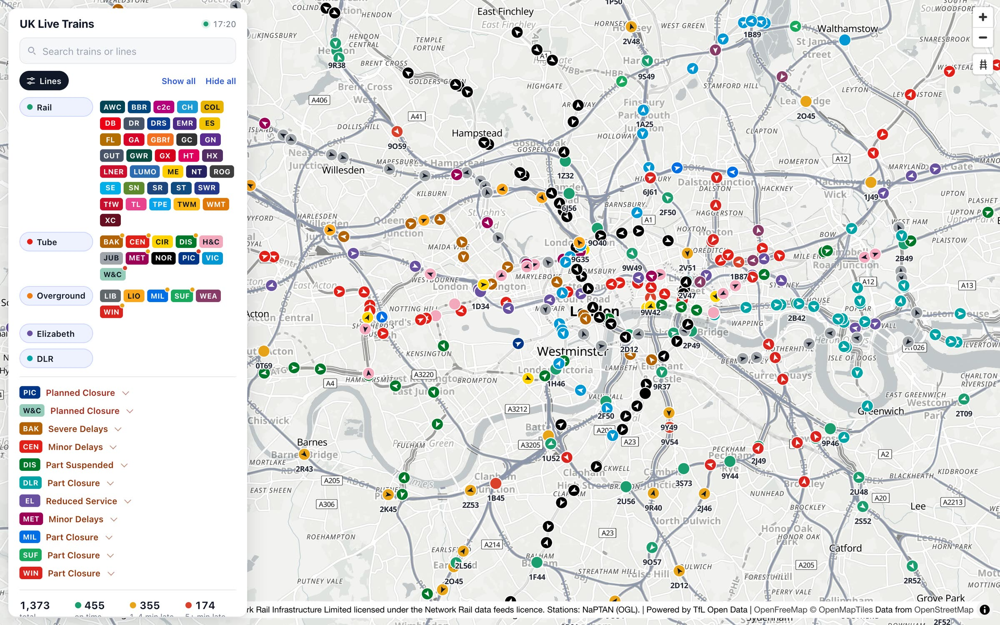
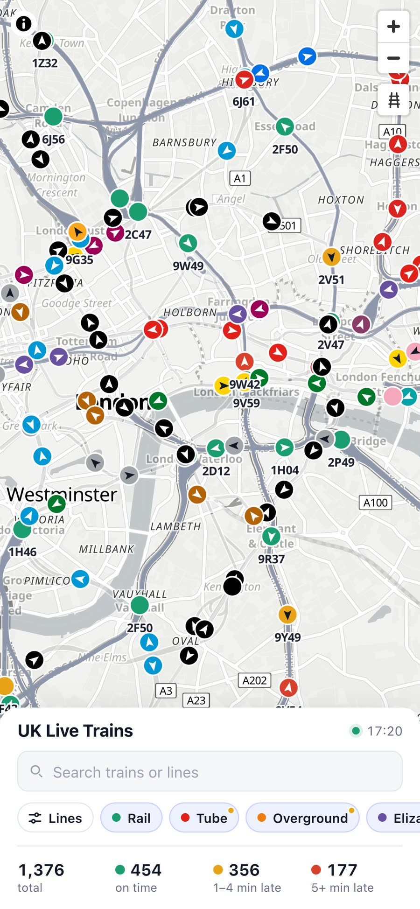
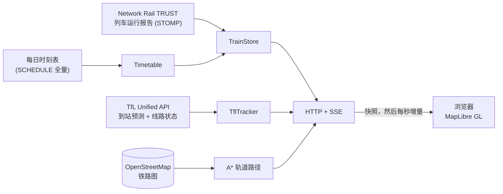

<div align="center">


# UK Live Trains

**大不列颠所有火车，实时跑在同一张地图上。**

国铁数据来自 Network Rail 开放数据，伦敦地铁、Overground、Elizabeth line 和 DLR 来自 TfL。<br>
每列车都沿着真实轨道移动，点开就能看到整条路线、下一站、晚点和速度。

[](https://github.com/simpleapples/uk-train-live/actions/workflows/ci.yml)
[](LICENSE)
[](package.json)
[](package.json)
[](#-docker-部署)

[快速开始](#-快速开始) · [功能](#-功能) · [原理](#-原理) · [部署](#-docker-部署) · [English](README.md)

<br>



<sub>一个周日下午：地图上同时有约 1450 列车。</sub>

</div>

---

## ✨ 功能

- 🚆 **所有列车，实时。** 向 Network Rail 报告位置的所有国铁客运和货运列车，加上 TfL 的 19 条线：11 条地铁线、6 条 Overground 线、Elizabeth line 和 DLR。
- 🛤️ **沿真实轨道走，不是直线。** 列车沿 OpenStreetMap 的轨道几何移动，用 A\* 在 2.5 万条边的铁路图上找路线。每条 TfL 线只在自己的轨道上走。
- 🧭 **方向和准点一眼看清。** 每个圆点里有一个箭头指向行驶方向。国铁按晚点着色，TfL 用线路颜色。
- 🗺️ **点一下就有整条路线。** 起点 → 终点，以及每个停靠站的计划、实际和预计时间，来自 Network Rail 的每日时刻表。列车走过的轨道会在它身后变浅。
- 🚦 **内置线路状态。** TfL 的停运和延误会标在对应线路上，地图上某条线没车时能看到原因（比如 "Piccadilly：计划停运"）。
- 🔎 **搜索和筛选。** 按车次号、线路、运营公司或目的地找车。网络、线路、运营公司可以任意组合显示，比如"只看 Central line 和 LNER"。
- ⚡ **快而轻。** 一条 Server-Sent Events 推送流，每秒推增量；全程 gzip；轨道几何批量取。服务器重启后列车还在。
- 📦 **零运行时依赖。** Node 直接运行 TypeScript 源码。`docker compose up` 就能上线。
- 📱 **手机可用**，底部抽屉式面板。

## 📸 截图

<table>
  <tr>
    <td width="50%"><br><sub><b>点一列车</b>，看它的路线、停靠站和时间。走过的轨道在身后变浅。</sub></td>
    <td width="50%"><br><sub><b>伦敦</b>：地铁按线路颜色，国铁按准点，放大后显示车次号。</sub></td>
  </tr>
  <tr>
    <td width="50%"><br><sub><b>选择线路和运营公司</b>，查看今天的停运和延误。</sub></td>
    <td width="50%" align="center"><br><sub><b>手机上。</b></sub></td>
  </tr>
</table>

## 🚀 快速开始

需要 **Node.js 22.18 或更新版本**。不用装任何东西，运行时没有依赖。

```bash
git clone https://github.com/simpleapples/uk-train-live.git
cd uk-train-live
npm run demo
```

打开 **http://localhost:3000**。

Demo 模式不需要账号。国铁是**模拟**的（28 个班次、约 200 列车，走和真实数据完全一样的处理流程），TfL 列车是**真实**的实时数据。

### 🔴 接入真实国铁数据

1. 在 [Network Rail Open Data](https://publicdatafeeds.networkrail.co.uk) 免费注册。订阅在 [My Feeds](https://publicdatafeeds.networkrail.co.uk/ntrod/myFeeds) 页面。名额上限 1000 人，先到先得。
2. 复制 `.env.example` 为 `.env`，填入 `NROD_USERNAME` 和 `NROD_PASSWORD`。
3. 运行：

   ```bash
   npm run live
   ```

第一次启动时，服务器会用同一个账号把 CORPUS 位置代码和当天的完整时刻表（约 140 MB，几秒钟）下载到 `state/`，之后每晚自动更新时刻表。一两分钟后地图上就有几百列真实列车，并随着列车报告位置越来越多。

## 🐳 Docker 部署

```bash
cp .env.example .env    # 填入 NROD_USERNAME 和 NROD_PASSWORD
docker compose up -d --build
```

- 固定用实时数据，不管 `.env` 里的 `FEED` 是什么。
- 换端口：`HOST_PORT=8080 docker compose up -d`。
- 时刻表、CORPUS 和地图上的列车存在 `state` volume 里，重启和升级后接着用。
- `docker stop` 时服务器会先保存列车再退出。容器有健康检查（`/api/status`）。
- 前面加 HTTPS 反向代理（nginx、Caddy）时，不要缓冲 `/api/stream`：它是 Server-Sent Events 长连接。服务器已经发送了 `X-Accel-Buffering: no`。

**为什么没用 Redis：** 数据都在内存里，对实时数据这是对的：快，总量也小（列车几 MB，当天时刻表约 15 MB）。重启丢数据的问题用定时存快照到 volume 解决了。等以后要跑多个网页实例、或者把接收数据和网页服务拆开时，再加 Redis 合适。

## 🧠 原理



- **没有任何公开数据提供 GPS 位置。** Network Rail 的 TRUST 数据在列车经过计时点时发一条报告：什么时候、晚了多少、下一个计时点是哪、还要几分钟。服务器给每列车保存一个"区间"（从哪、到哪、出发时间、运行时间），浏览器取两点之间的轨道，让列车沿轨道滑过去。所以服务器只推送变化，不推送位置。
- **每列车对上它的时刻表。** Live 模式读取 Network Rail 每日完整时刻表，只保留今天运行的约 2.5 万个班次（内存约 15 MB）。用激活消息里的班次编号对；服务器启动前就在跑的车，用"车次号 + 地点 + 计划时间"来对。约 93% 的列车能对上，对不上的主要是当天临时加开的车。
- **TfL 给的是预测，不是位置。** Unified API 告诉我们每列车到后面各站还要几秒。上一站按线路站序推出，速度从各站预测的时间差算出，位置看区间还剩多少。DLR 预测没有车号，所以从各站的预测反推出列车。
- **轨道几何来自 OpenStreetMap。** 全国路网来自 OpenFreeMap 矢量瓦片，TfL 线路来自 OSM 路线关系，每条线一张图。道岔连接按"线头 25 米内有其他线就连上"重建。

<details>
<summary><b>目录结构</b></summary>

| 路径 | 作用 |
|---|---|
| `src/server.ts` | 入口：选择数据源（`demo` 或 `nrod`），把各部分接起来 |
| `src/app.ts` | HTTP：静态文件、`/api/trains`、`/api/train`、`/api/paths`、`/api/stream`（SSE） |
| `src/engine/trainStore.ts` | TRUST 消息 → 每列车在哪（核心） |
| `src/engine/track.ts`、`paths.ts` | 铁路图、吸附和 A* 寻路；两点之间轨道的缓存 |
| `src/engine/trainDetails.ts` | 选中列车的停靠站、上一站 / 下一站、路线几何 |
| `src/schedule/` | 每日时刻表：下载、解析、把列车对上班次 |
| `src/tfl/tflTracker.ts` | TfL 到站预测 → 列车位置、速度和路线；线路状态 |
| `src/feeds/` | 实时（NROD）和模拟数据源、运营公司代码、门户文件下载 |
| `src/stomp/` | 小巧的 STOMP 客户端，带心跳和重连（无依赖） |
| `public/` | 地图页面（MapLibre GL，原生 JS） |
| `scripts/` | 重建 `data/` 里的数据（车站、轨道、TfL 线路） |

</details>

<details>
<summary><b>重建地图数据</b></summary>

构建好的数据已经提交在 `data/` 里。要重建（需要先 `npm install` 安装构建工具）：

```bash
npm run data:stations   # NaPTAN 车站 → data/stations.json
npm run data:track      # 从 OpenFreeMap 瓦片提取 OSM 铁路图 → data/track.json.gz
npm run data:tfl        # TfL 线路、车站和每条线的轨道 → data/tfl*.json*
```

</details>

## ⚠️ 已知限制

- **位置是估算的**：沿轨道在两次报告之间插值，不是 GPS。
- **TRUST 只在计时点报告**，计时点之间可能隔好几公里。没有坐标的道岔，从上一个已知车站接着走。
- **速度是区间平均值**：估算值来自时刻表或 TfL 预测，实测值来自两次报告之间，不是瞬时速度。
- **当天临时加开的车**（VSTP）不在每日时刻表里，只显示"From 某站"，没有完整路线。
- **OpenRailwayMap 的公共瓦片**只适合原型，访问量大的公开网站应该自建。

## 🛣️ 路线图

- [ ] 接入 VSTP，覆盖当天临时加开的车
- [ ] 接入 TD（Train Describer），按区域做到信号区段级精度
- [ ] 接入 Darwin：预测晚点、站台和取消
- [ ] 只推送视野内的列车
- [ ] 回放某一天

欢迎提想法和 PR。

## 🤝 参与贡献

```bash
npm install     # 开发工具：TypeScript 和 Vitest
npm test        # 80 多个测试
npm run typecheck
```

请保持零运行时依赖，并确保测试和类型检查通过。

## 📜 数据与许可

代码使用 [MIT](LICENSE) 许可。用到的数据有各自的条款，应用在地图的 ⓘ 里显示了要求的署名：

| 数据 | 来源 | 许可 / 署名 |
|---|---|---|
| 列车运行、时刻表、CORPUS | [Network Rail Open Data](https://publicdatafeeds.networkrail.co.uk) | Network Rail 数据许可：*"Contains information of Network Rail Infrastructure Limited licensed under the Network Rail data feeds licence."* 不使用 Network Rail、National Rail 和各火车公司的 logo，运营公司用文字小标表示。 |
| 地铁、Overground、Elizabeth line、DLR | [TfL Unified API](https://api-portal.tfl.gov.uk) | *Powered by TfL Open Data.* 含 OS 数据 © Crown copyright and database rights。 |
| 车站坐标（`data/stations.json`） | NaPTAN（英国交通部） | Open Government Licence v3.0 |
| 轨道几何（`data/track.json.gz`、`data/tfl-track.json.gz`） | © [OpenStreetMap](https://www.openstreetmap.org/copyright) 贡献者，经 [OpenFreeMap](https://openfreemap.org) / OpenMapTiles 和 Overpass | [ODbL](https://opendatacommons.org/licenses/odbl/) |
| 底图和铁路图层 | [OpenFreeMap](https://openfreemap.org)、[OpenRailwayMap](https://www.openrailwaymap.org) | © OpenMapTiles © OpenStreetMap 贡献者；CC-BY-SA |

> 本项目与 Network Rail、National Rail、伦敦交通局（TfL）及任何火车运营公司**无关联**。

## 🙏 致谢

[Network Rail Open Data](https://publicdatafeeds.networkrail.co.uk) 和 [Open Rail Data](https://wiki.openraildata.com) 社区 wiki、[TfL Open Data](https://tfl.gov.uk/info-for/open-data-users/)、[OpenStreetMap](https://www.openstreetmap.org) 贡献者、[OpenFreeMap](https://openfreemap.org)、[OpenRailwayMap](https://www.openrailwaymap.org) 和 [MapLibre](https://maplibre.org)。

<div align="center"><sub>如果觉得有意思，点个 ⭐ 能让更多人看到它。</sub></div>
